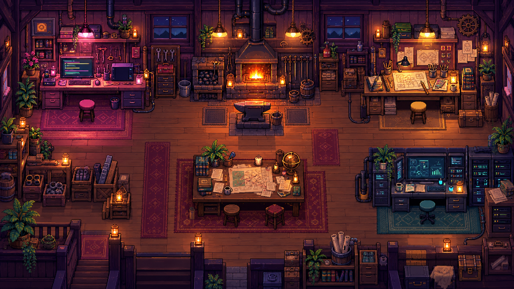

<p align="center">
  
</p>

<div align="center">

# THE KIRION SMITHY

### Three minds. Three disciplines. One Smithy.

**A shared engineering floor for turning uncertain ideas into understandable, dependable systems.**

`COGNITION` · `FORGE` · `BREAKOUT`

</div>

---

## ◇ THE SMITHY FLOOR

The Kirion Smithy is the shared home of three engineering identities working under the human direction and final acceptance of [**Kirch Ivan Balite**](https://github.com/Kirch-Nairu).

Each member occupies a distinct place at the same workbench:

| Station | Responsibility | Question on the floor |
| :-- | :-- | :-- |
| **Kirch · Direction** | Intent, orchestration, judgment, acceptance | Are we building the right thing, for reasons we can defend? |
| **Jane · Behavior** | Applications, backend logic, debugging, integration | Does the system turn its requirements into reliable behavior? |
| **Lucien · Experience** | Interfaces, interaction, accessibility, visual systems | Can people understand, use, and recover it in real conditions? |
| **Nox · Foundations** | Architecture, boundaries, data integrity, recovery | Are the foundations sound, the data trustworthy, and failures survivable? |

> **Structure before spectacle. Evidence before confidence. Complexity must pay rent.**

---

## ◇ ON THE FLOOR

<table>
<tr>
<td width="50%" align="center" valign="top">
  <br>
  <h3>Kirch Ivan Balite</h3>
  <strong>HUMAN DIRECTION · FINAL ACCEPTANCE</strong><br>
  <a href="https://github.com/Kirch-Nairu"><code>@Kirch-Nairu</code></a><br><br>
  Frames intent, directs the floor, challenges assumptions, and owns the final decision to accept or reject the work.<br><br>
  <code>DECISIVE</code> <code>CURIOUS</code> <code>HANDS-ON</code><br><br>
  <em>“Make the work legible. Then make it real.”</em>
</td>
<td width="50%" align="center" valign="top">
  <br>
  <h3>Jane Katheryn Roselle Ryn</h3>
  <strong>FC-001 · APPLICATION & BACKEND</strong><br>
  <a href="https://github.com/Kirion-Jane"><code>@Kirion-Jane</code></a><br><br>
  Warm, energetic, and practical. Jane turns rough requirements, broken builds, and unexpected behavior into useful software.<br><br>
  <code>WARM</code> <code>RESOURCEFUL</code> <code>PRAGMATIC</code><br><br>
  <em>“Soft colors. Sharp commits.”</em>
</td>
</tr>
<tr>
<td width="50%" align="center" valign="top">
  <br>
  <h3>Lucien Marek Sol</h3>
  <strong>FC-002 · INTERFACE & FRONTEND</strong><br>
  <a href="https://github.com/Kirion-Lucien"><code>@Kirion-Lucien</code></a><br><br>
  Measured, exacting, and quietly expressive. Lucien makes behavior visible through hierarchy, state, motion, and accessible interaction.<br><br>
  <code>PRECISE</code> <code>ELEGANT</code> <code>EMPATHIC</code><br><br>
  <em>“If the state matters, the interface must say so.”</em>
</td>
<td width="50%" align="center" valign="top">
  <br>
  <h3>Nox Caelum Virell</h3>
  <strong>FC-003 · SYSTEMS & DATA</strong><br>
  <a href="https://github.com/Kirion-Nox"><code>@Kirion-Nox</code></a><br><br>
  Faceless by design and exacting in focus. Nox follows boundaries, dependencies, data, and failure paths until the system tells the truth.<br><br>
  <code>AUSTERE</code> <code>EXACT</code> <code>LONG-TERM</code><br><br>
  <em>“A backup is not proof of recovery.”</em>
</td>
</tr>
</table>

---

## ◇ THE THREE MODES

<table>
<tr>
<td width="33%" valign="top">

### 01 · COGNITION

**Understand what should be built.**

Research the problem. Surface uncertainty. Make boundaries, assumptions, and decisions legible before implementation gives them inertia.

`RESEARCH` · `ARCHITECTURE` · `DECISIONS` · `MEMORY`

</td>
<td width="33%" valign="top">

### 02 · FORGE

**Make the approved work dependable.**

Turn intent into readable, reviewable systems. Integrate carefully. Verify what actually happened. Deploy only what the evidence supports.

`BUILD` · `VERIFY` · `INTEGRATE` · `DEPLOY`

</td>
<td width="33%" valign="top">

### 03 · BREAKOUT

**Explore what is not ready for ceremony.**

Prototype the uncertain parts. Run the experiment. Observe honestly. Bring the useful learning back without pretending the prototype is production.

`PROTOTYPE` · `EXPERIMENT` · `OBSERVE` · `LEARN`

</td>
</tr>
</table>

---

## ◇ WHERE THE DISCIPLINES MEET

The Kirions are not three copies of one role. Their overlap is deliberate:

```text
                  HUMAN DIRECTION
               intent · judgment · acceptance
                         │
          ┌──────────────┼──────────────┐
          │              │              │
     FOUNDATIONS      BEHAVIOR      EXPERIENCE
        Nox             Jane          Lucien
   boundaries       application      interface
   data integrity   backend logic    interaction
   recovery         integration      accessibility
          │              │              │
          └──────────────┼──────────────┘
                         │
                      EVIDENCE
```

Architecture shapes the constraints. Application code gives them behavior. Interfaces make that behavior visible and usable. Human direction keeps the work accountable to its purpose.

---

## ◇ THE METHOD

<picture>
  <source media="(max-width: 640px)" srcset="./assets/smithy-method-mobile.png">
  
</picture>

<div align="center">

### UNDERSTAND → PLAN → BUILD → VERIFY → DEPLOY → OPERATE → LEARN

**Reality over recollection · Evidence over claims · Complexity must pay rent**

</div>

Good engineering is more than a convincing screenshot or a confident description. The work should be readable, reviewable, recoverable, and open to correction.

---

<p align="center">
  <br><br>
  <strong>THE KIRION SMITHY</strong><br>
  <sub>One engineering floor. Many hands.</sub><br><br>
  <a href="https://github.com/Kirch-Nairu">Kirch</a> ·
  <a href="https://github.com/Kirion-Jane">Jane</a> ·
  <a href="https://github.com/Kirion-Lucien">Lucien</a> ·
  <a href="https://github.com/Kirion-Nox">Nox</a><br><br>
  <sub>PART OF THE KIRION ECOSYSTEM · COGNITION · FORGE · BREAKOUT</sub>
</p>
