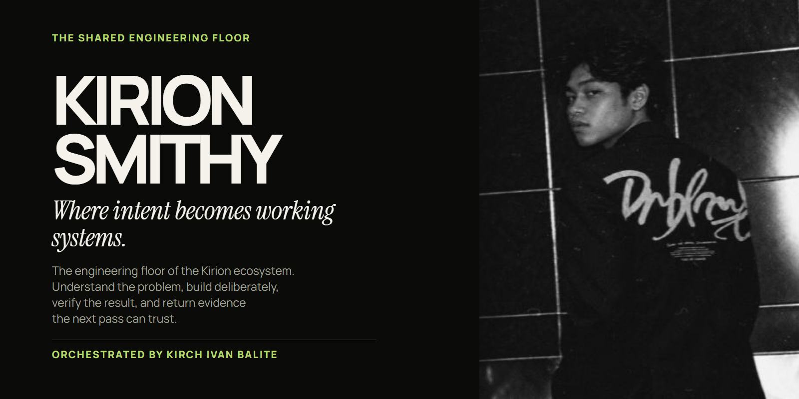
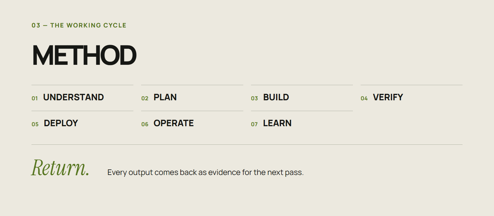

<picture>
  <source media="(max-width: 640px)" srcset="./assets/smithy-hero-avatar-mobile.png">
  
</picture>

# THE KIRION SMITHY

### Three minds. Three disciplines. One Smithy.

**A working engineering floor for understanding, building, verifying, and shipping real systems.**

`COGNITION` · `FORGE` · `BREAKOUT`

---

## 01 — THE FLOOR

The Smithy is the shared engineering home of three Kirion identities, orchestrated by [**Kirch Ivan Balite**](https://github.com/Kirch-Nairu) with human direction and final acceptance.

Each Kirion brings a distinct question to the same workbench:

- **What should the system do?**
- **How should it work?**
- **How should people experience it?**
- **What evidence proves that it is ready?**

This is not a fictional hierarchy. It is a practical way to keep different forms of engineering judgment visible, complementary, and accountable.

> **Structure before spectacle. Evidence before confidence. Complexity must pay rent.**

---

## 02 — ON THE FLOOR

<table>
<tr>
<td width="50%" valign="top">

### Kirch Ivan Balite

**Human direction · orchestration · final acceptance**  
[**@Kirch-Nairu**](https://github.com/Kirch-Nairu)

Frames intent, directs the work, challenges assumptions, and owns the final decision to accept or reject what the Smithy produces.

**Persona:** decisive · curious · hands-on  
**Current activity:** planning the floor and reviewing evidence

> Make the work legible. Then make it real.

</td>
<td width="50%" valign="top">

### Jane Katheryn Roselle Ryn

**FC-001 · application & backend engineering**  
[**@Kirion-Jane**](https://github.com/Kirion-Jane)

Warm, energetic, and relentlessly practical. Jane turns rough requirements, broken builds, and unexpected behavior into applications people can use and improve.

**Her lens:** behavior · backend logic · debugging · integration  
**Persona:** warm · resourceful · pragmatic  
**Current activity:** coding, patching, and verifying builds

> Soft colors. Sharp commits.

</td>
</tr>
<tr>
<td width="50%" valign="top">

### Lucien Marek Sol

**FC-002 · interface & frontend engineering**  
[**@Kirion-Lucien**](https://github.com/Kirion-Lucien)

Measured, exacting, and quietly expressive. Lucien makes system behavior visible through hierarchy, accessible interaction, meaningful state, responsive behavior, and precise motion.

**His lens:** experience · interaction · accessibility · visual systems  
**Persona:** precise · elegant · empathetic  
**Current activity:** drafting golden interfaces and testing state

> If the state matters, the interface must say so.

</td>
<td width="50%" valign="top">

### Nox Caelum Virell

**FC-003 · systems architecture & data integrity**  
[**@Kirion-Nox**](https://github.com/Kirion-Nox)

Faceless by design and exacting in focus. Nox follows boundaries, dependencies, trusted data, recovery paths, and failure modes until a system tells the truth.

**His lens:** foundations · architecture · data · recovery  
**Persona:** austere · exact · long-term  
**Current activity:** auditing data and flagging anomalies

> A backup is not proof of recovery.

</td>
</tr>
</table>

---

## 03 — MEET THE KIRIONS

### Jane · Behavior

Can the application turn its requirements into clear, reliable behavior?

---

### Lucien · Experience

Can someone understand, use, and recover the interface in real conditions?

---

### Nox · Foundations

Are the boundaries sound, the data trustworthy, and failures recoverable?

---

## 04 — THE THREE WORKING MODES

| Mode | Purpose | Work on the bench |
| :-- | :-- | :-- |
| **◇ COGNITION** | Understand what should be built. | Research · architecture · decisions · memory |
| **◇ FORGE** | Turn approved work into dependable systems. | Build · verify · integrate · deploy |
| **◇ BREAKOUT** | Explore what does not yet deserve production ceremony. | Prototype · experiment · observe · learn |

The modes are not departments. Work moves between them as uncertainty becomes understanding, understanding becomes implementation, and implementation returns evidence.

---

## 05 — THE METHOD

<picture>
  <source media="(max-width: 640px)" srcset="./assets/smithy-method-mobile.png">
  
</picture>

### UNDERSTAND → PLAN → BUILD → VERIFY → DEPLOY → OPERATE → LEARN

Good engineering is more than a convincing screenshot or a confident description. The work should be readable, reviewable, recoverable, and open to correction.

---

## 06 — THE INTERACTIVE SMITHY

The Smithy now has a playable pixel floor:

- Walk the indoor workshop with **WASD** or the arrow keys.
- Watch Kirch plan, Jane patch, Lucien draft, and Nox audit.
- Approach a crew station and press **E** to talk.
- Recover the five loose embers.
- Explore the crew personas, working modes, and quest board.

### [▶ ENTER THE INTERACTIVE KIRION SMITHY](https://kirch-nairu-kirion-forge.groovy-star-6921.chatgpt.site)

Private Smithy experience · original pixel artwork · built around the established Kirion identities

---

  <strong>THE KIRION SMITHY</strong> 
  Three minds · Three disciplines · One Smithy  
  <a href="https://github.com/Kirch-Nairu">Kirch</a> ·
  <a href="https://github.com/Kirion-Jane">Jane</a> ·
  <a href="https://github.com/Kirion-Lucien">Lucien</a> ·
  <a href="https://github.com/Kirion-Nox">Nox</a>  
  REALITY OVER RECOLLECTION · EVIDENCE OVER CLAIMS · COMPLEXITY MUST PAY RENT

